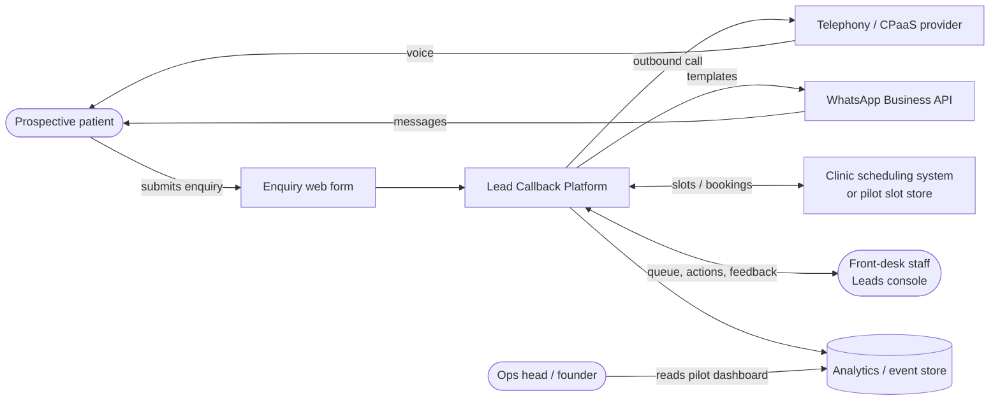
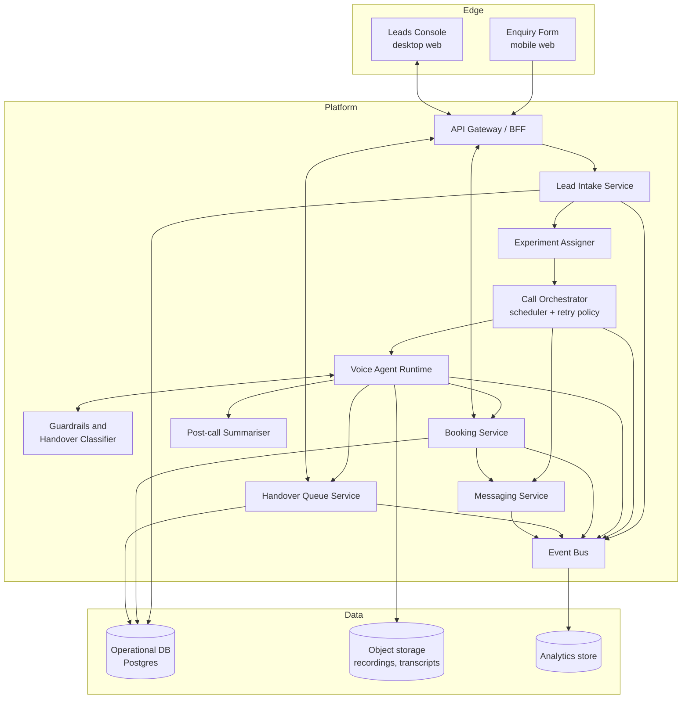
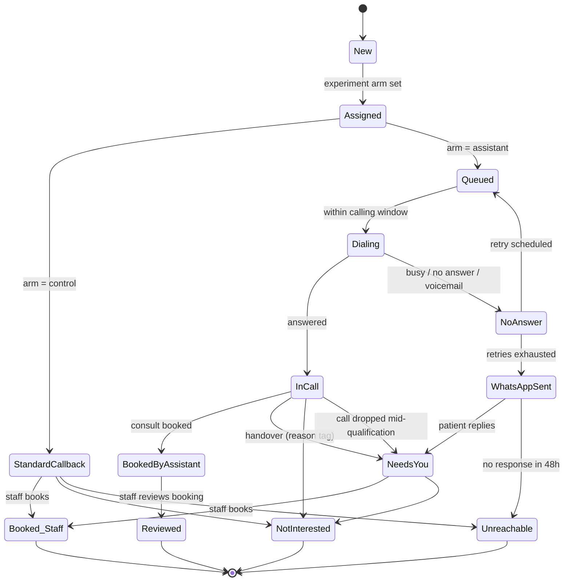
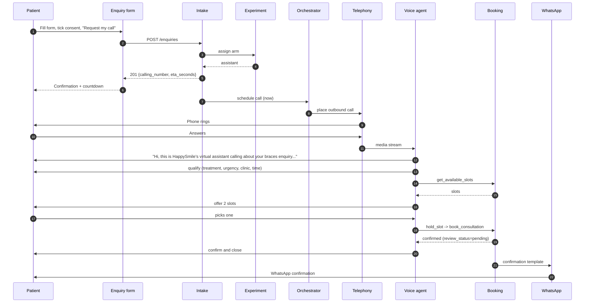
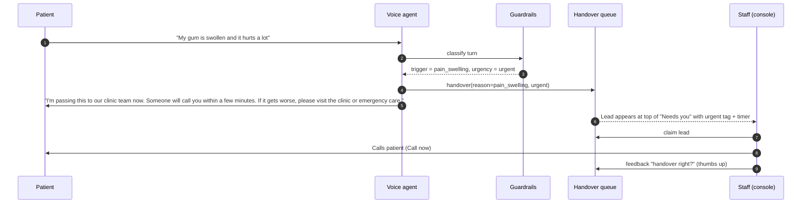
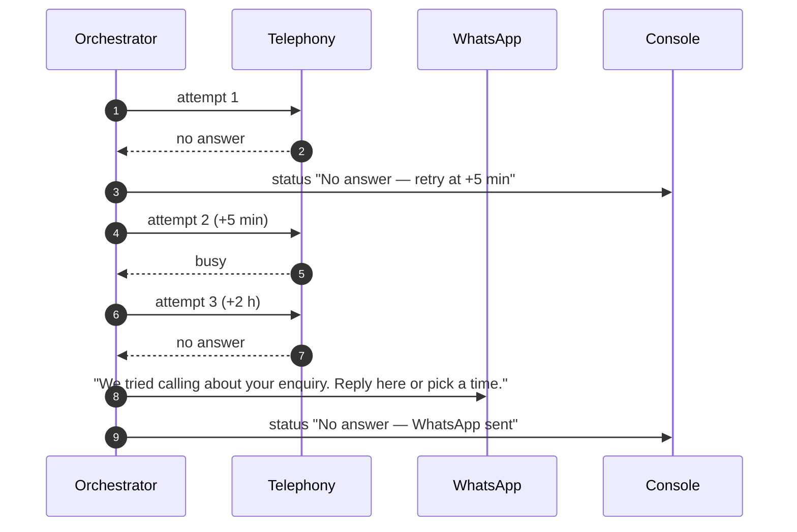
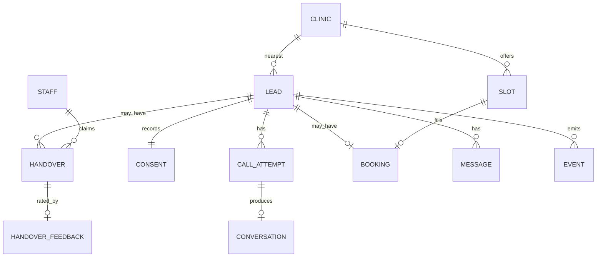

# HappySmile Lead Callback Assistant — Architecture

> Based on [context.md](context.md) (which restates [problemStatement.txt](problemStatement.txt)).
> Everything here is a **proposal for a fictional case**. Vendor names are examples, not decisions, except **Groq**, which is the chosen LLM provider (see [§4.13](#413-llm-usage-groq)). Items marked **[Assumption]** need validation with HappySmile before build (see [§17 Open questions](#17-open-questions-and-assumptions)).

---

## Table of contents

1. [Purpose and scope](#1-purpose-and-scope)
2. [Design principles](#2-design-principles)
3. [System context](#3-system-context)
4. [Component architecture](#4-component-architecture)
5. [Lead lifecycle (state machine)](#5-lead-lifecycle-state-machine)
6. [Key flows (sequence diagrams)](#6-key-flows-sequence-diagrams)
7. [Voice agent design](#7-voice-agent-design)
8. [Handover design](#8-handover-design)
9. [Front-desk console (Leads queue)](#9-front-desk-console-leads-queue)
10. [Pilot experiment design](#10-pilot-experiment-design)
11. [Data model](#11-data-model)
12. [API surface](#12-api-surface)
13. [Non-functional requirements](#13-non-functional-requirements)
14. [Compliance, privacy and safety](#14-compliance-privacy-and-safety)
15. [Observability and metrics](#15-observability-and-metrics)
16. [Failure modes and mitigations](#16-failure-modes-and-mitigations)
17. [Open questions and assumptions](#17-open-questions-and-assumptions)
18. [4-week delivery plan](#18-4-week-delivery-plan)
19. [Prototype (mockup) architecture](#19-prototype-mockup-architecture)

---

## 1. Purpose and scope

### Problem

About 300 people a day enquire online across 12 clinics. Staff call back 4–6 hours later and about 30% book. HappySmile wants an AI voice assistant that **reaches each person within minutes**, **qualifies** them, and either **books a consultation** or **hands over to staff**.

### What this architecture covers

| In scope (pilot, first 4 weeks) | Out of scope (explicitly NOT doing) |
|---|---|
| Web enquiry form with clear AI disclosure and consent | An AI that hides that it is an AI |
| Outbound AI call within ~2 minutes (English / Hindi) | Clinical advice, diagnosis, or treatment recommendations |
| Qualification: treatment, urgency, clinic, preferred slot | Quoting final prices or negotiating EMI terms |
| Booking a **consultation** slot (not a treatment) | Booking procedures, payments, or deposits |
| Structured handover to a staff queue with reasons | Live warm transfer to staff mid-call (phase 2) |
| Retries and WhatsApp fallback for no-answer | A WhatsApp chatbot (v1 WhatsApp is templates only) |
| Front-desk Leads console with review of every AI booking | Replacing the front desk or removing staff from the loop |
| Randomised control group (standard callback) | Inbound call handling, reminders, no-show recovery |
| Event logging for conversion-by-arm measurement | Integration with all 12 clinics on day one |

---

## 2. Design principles

1. **Speed is the hypothesis, not the conclusion.** The ops head's "3x" comes from leads staff *happened* to reach fast, which could be selection bias (eager leads, quiet hours). The system builds in a randomised control arm so the pilot measures whether speed *causes* the lift.
2. **Disclose, then delight.** The assistant identifies itself as a virtual assistant on the form and in the first sentence of the call. It should sound warm and natural, but it never claims to be human. This resolves the founder's ask in a way patients and regulators can accept.
3. **Staff stay in control.** The front desk sees every lead, every handover, and every AI booking (with a Review link). The AI handles the routine first contact; staff handle judgement calls. This answers the front-desk lead's concern without making staff the bottleneck.
4. **Fail toward a human.** Any uncertainty (low speech-recognition confidence, a clinical question, pain, a system error) routes the lead to staff. Nothing fails silently.
5. **Narrow and safe beats broad and clever.** The agent has a small set of goals and tools. Its allowed actions are enforced in code, not only in the prompt.
6. **Measure from day one.** Every state change is an event. The metrics in the top strip and the pilot readout come from the same event log.

---

## 3. System context



**External dependencies**

| Dependency | Role | Example options |
|---|---|---|
| Telephony / CPaaS | Outbound PSTN calls from a registered Indian number, media streaming, recording | Exotel, Plivo, Twilio |
| Speech-to-text (streaming) | English, Hindi, Hinglish code-switching | Cloud STT with Indic support |
| LLM | Dialogue policy, guardrail classification, slot extraction, summaries | **Groq** (decided): OpenAI-compatible API with tool calling and JSON output. See [§4.13](#413-llm-usage-groq) |
| Text-to-speech | Natural Indian-English and Hindi voices | Cloud TTS with Indic voices |
| WhatsApp Business API | Confirmations, no-answer follow-ups | Meta Cloud API or a BSP |
| Clinic scheduling | Source of truth for consultation slots | Existing practice-management system **[Assumption]** |

---

## 4. Component architecture



### 4.1 Enquiry Form (mobile web)

- Fields: name, mobile number, treatment (braces/aligners, whitening, implants, other), nearest clinic.
- Contact preference: **Call me now** (default), **Call me at a time I pick**, **WhatsApp me instead**.
- Language: English / Hindi.
- Disclosure text above the submit button that names the calling number, says it is a virtual assistant, and explains "say 'talk to a person' at any time".
- Consent checkbox for the call and WhatsApp updates. Submit is disabled until it is ticked.
- After submit: a confirmation state showing the calling number and a countdown.
- Client-side validation of Indian mobile numbers (10 digits, starts with 6–9).

### 4.2 Lead Intake Service

Responsibilities:
- Validate and normalise the payload (E.164 phone format, trimmed name).
- **Deduplicate**: the same phone number within 24 hours merges into the existing lead rather than triggering a second call.
- **Persist consent**: store the exact disclosure text version, timestamp, IP/user agent and language as an immutable consent record.
- Reject or flag obvious junk (test numbers, repeated rapid submissions, i.e. rate limiting).
- Emit `lead.created`.

### 4.3 Experiment Assigner

- Assigns each new lead to an arm: `assistant` or `standard_callback` (control).
- Deterministic hash of `lead_id` against a configurable split, stratified by clinic, so assignment cannot be gamed or influenced by staff.
- Leads that chose **WhatsApp me instead** or **a time I pick** are still randomised. Their arm decides who acts first (assistant or staff), so the arms stay comparable.
- Assignment is written once and never changed. Emits `lead.assigned`.

### 4.4 Call Orchestrator

- Owns *when* a call happens. It is a durable scheduler (job table plus workers), not in-memory timers.
- **Calling window**: calls are placed only within permitted hours (configurable, e.g. 09:00–21:00 IST). Enquiries outside the window get an immediate WhatsApp acknowledgement and a call scheduled for the next opening, at a lower priority than new real-time leads.
- **Retry policy** (configurable):

  | Attempt | Delay after previous | Action |
  |---|---|---|
  | 1 | Within ~60 s of submit | AI call |
  | 2 | +5 min | AI call |
  | 3 | +2 h | AI call |
  | — | After attempt 3 | WhatsApp template ("We tried to reach you…") with a reply option; lead stays in **No answer** |

- Handles busy, no-answer, voicemail detection, and invalid numbers (ends retries, flags the lead).
- Concurrency limit per caller ID so the provider does not flag the number as spam.
- **Circuit breaker**: if the voice agent or telephony is unhealthy, new `assistant`-arm leads are routed to the staff queue with reason `system_fallback`, so no lead is lost.

### 4.5 Voice Agent Runtime

Real-time pipeline per call:

```
PSTN audio  ->  streaming STT  ->  dialogue policy (LLM + state machine)  ->  TTS  ->  PSTN audio
                                       |            ^
                                  tool calls     guardrails
```

- A **state machine** sets the conversation stages (see [§7](#7-voice-agent-design)). The LLM (served by Groq, see [§4.13](#413-llm-usage-groq)) handles language understanding and phrasing *within* a stage. This keeps behaviour predictable and testable.
- Barge-in support: the caller can interrupt TTS.
- Language is preset from the form. Hindi–English code-switching is expected. The caller can switch language mid-call.
- Tools available to the agent (allowlist, enforced server-side):
  - `get_available_slots(clinic_id, date_range, treatment)`
  - `hold_slot(slot_id)` / `book_consultation(lead_id, slot_id)`
  - `handover(lead_id, reason, urgency, note)`
  - `mark_not_interested(lead_id, reason)`
  - `end_call()`
- Writes the recording and the full transcript to object storage. Emits `call.started`, `call.ended`, and outcome events.

### 4.6 Guardrails and Handover Classifier

Runs on every caller turn and on every agent response before TTS.

- **Input-side triggers** (caller says something that needs a human):
  - Explicit request: "talk to a person", "insaan se baat karni hai", or anything with the same meaning.
  - Pain, swelling, bleeding, trauma or other urgency signals → `urgent`.
  - Price, EMI or insurance questions beyond published "starting from" information.
  - Clinical questions ("Is an implant safe if I have diabetes?").
  - Low STT confidence on two consecutive turns, or repeated "I didn't understand" → `couldnt_understand`.
  - Distress, anger, or the caller saying they are a minor.
- **Output-side checks** (agent about to say something it should not):
  - Any medical advice, diagnosis, or outcome promise → blocked and replaced with a handover line.
  - Any claim to be human → blocked.
  - Prices not in the approved price card → blocked.
- Implementation: rules and keyword lists for high-recall safety triggers, plus a small, fast LLM classifier on Groq for paraphrases. If the classifier times out or errors, the rules-only result stands. The rules run first and cannot be overridden by the LLM.

### 4.7 Booking Service

- Adapter interface over the clinic scheduling system:
  `listSlots`, `holdSlot(ttl)`, `confirmBooking`, `cancelBooking`.
- **Pilot fallback [Assumption]**: if there is no API, a HappySmile-managed slot table per pilot clinic, edited by the front desk daily. This is good enough to test the hypothesis without a deep integration.
- Holds have a TTL (e.g. 3 minutes) to prevent double-booking while the caller confirms.
- Every AI booking is created with `review_status = pending` and appears with a **Review** link in the console.
- Triggers a WhatsApp confirmation (slot, dentist, clinic address, map link, how to reschedule).

### 4.8 Messaging Service

- Sends WhatsApp **pre-approved templates** only (v1): immediate acknowledgement, booking confirmation, no-answer follow-up, scheduled-call reminder.
- Records the delivery status (sent / delivered / read / failed) on the lead timeline.
- Inbound WhatsApp replies are attached to the lead and surface it in **Needs you** (staff reply; there is no bot in v1).

### 4.9 Handover Queue Service

- Holds every lead that needs staff action, with reason tags, urgency, and a waiting-time timer against an SLA (target 15 minutes; urgent target 5 minutes, configurable).
- Sort order: urgent first, then by longest waiting.
- **Claiming**: when a staff member opens a lead or presses "Call now", the lead is soft-locked to them so two people do not call the same patient.
- Escalation: past the SLA, the lead is highlighted. Past 2× the SLA, the clinic manager is notified.

### 4.10 Post-call Summariser

- After each call, produces:
  - a **3-line summary** (who, what they want, what happened / next step),
  - **captured answers**: treatment, preferred slot, urgency, language,
  - a **transcript snippet** around the handover moment.
- The summary is generated by a Groq-hosted LLM from the transcript (JSON output) and validated against the structured fields. If they conflict, the structured fields win and the summary is regenerated.

### 4.11 Leads Console (desktop web)

Described in [§9](#9-front-desk-console-leads-queue).

### 4.12 Event Bus and Analytics

- Every service emits domain events (append-only). These feed:
  - the console's live top strip,
  - the pilot dashboard (conversion by arm, by clinic, by hour),
  - quality review (handover thumbs up/down, booking review outcomes).

### 4.13 LLM usage (Groq)

The platform uses an LLM in three places. All LLM calls go to **Groq**. Its very low time-to-first-token matters most in a live phone call, where every pause is audible.

| Where | Job | Model tier on Groq | Call pattern | Output |
|---|---|---|---|---|
| Voice Agent Runtime ([§4.5](#45-voice-agent-runtime)) | Understand the caller's turn within the current stage, extract answers, pick a tool, phrase the reply | Larger instruction-tuned model with tool calling | Streaming, once per caller turn | Streamed text + tool calls |
| Guardrails ([§4.6](#46-guardrails-and-handover-classifier)) | Detect paraphrased handover triggers; check agent output before TTS | Small, fast model | Non-streaming JSON, per turn, **in parallel** with the dialogue call | `{trigger, reason_tag, urgency, confidence}` |
| Post-call Summariser ([§4.10](#410-post-call-summariser)) | 3-line summary + captured answers | Larger model | Asynchronous, after the call ends | JSON validated against a schema |

**Integration**
- One `LlmClient` module wraps Groq's OpenAI-compatible Chat Completions endpoint. No other code calls Groq directly, so changing a model is a config change.
- Model IDs are set in config (`LLM_DIALOGUE_MODEL`, `LLM_GUARD_MODEL`, `LLM_SUMMARY_MODEL`). They are chosen from Groq's model list at build time and pinned to exact IDs. Groq retires models from time to time, so someone needs to watch its deprecation notices.
- `GROQ_API_KEY` lives in a secrets manager on the server only. The enquiry form and the Leads console never call Groq.
- Temperature is low (about 0–0.3) for dialogue and 0 for the classifier and summariser. Prompt templates are versioned so metric changes can be traced to prompt changes.
- Tool calls are checked server-side against the allowlist. A malformed or disallowed tool call leads to a handover, not a retry loop.

**Timeouts, limits and fallbacks**

| Situation | Behaviour |
|---|---|
| Dialogue first token takes longer than ~800 ms | Play a pre-recorded filler line ("One moment, let me check…") and retry once; a second failure hands over with `system_fallback` |
| Classifier timeout or error | The rules-only result stands, which is the safe default |
| Summariser failure | Retry in the background with backoff; meanwhile the console shows the transcript snippet without a summary |
| Rate limited (HTTP 429) | Jittered retry if it fits the latency budget; otherwise the same fallback as a timeout |
| Groq unavailable | The circuit breaker sends new assistant-arm leads to the staff queue ([§4.4](#44-call-orchestrator)) |

**Capacity check:** about 10 concurrent calls × one caller turn every ~5 s × 2 LLM calls per turn ≈ 4 requests/s at peak, plus summaries. Before go-live, confirm that the Groq plan's per-model request and token limits cover this with room to spare.

**Not used for:** live speech-to-text and text-to-speech. These stay with dedicated streaming speech providers that support Hindi and Hinglish. Groq hosts Whisper for file-based transcription. That could optionally re-transcribe recordings after the call to improve summaries, but it is not a live streaming recogniser.

**Data handling:** transcripts sent to Groq contain personal data and sometimes health mentions. Send only what each call needs: never the phone number, and the first name only when the reply needs it. Redact the stored copies of prompts and responses used for quality review. Groq processes data outside India **[Assumption: confirm current processing regions and retention terms]**. That needs a DPDP review and a data processing agreement before the pilot.

---

## 5. Lead lifecycle (state machine)



Notes:
- **WhatsApp me instead** in the assistant arm: the lead goes straight to `WhatsAppSent` (acknowledgement template) and then to `NeedsYou` with a `whatsapp_preferred` channel tag.
- **Call me at a time I pick**: the lead goes to `Queued` with a `scheduled_at` time. Reminder WhatsApp 10 minutes before.

---

## 6. Key flows (sequence diagrams)

### 6.1 Happy path — assistant books a consultation



### 6.2 Handover — pain or swelling



### 6.3 No answer — retries then WhatsApp



---

## 7. Voice agent design

### 7.1 Conversation stages

| # | Stage | Goal | Exit conditions |
|---|---|---|---|
| 1 | **Open and disclose** | "Hi [name], this is HappySmile's virtual assistant, calling about the [treatment] enquiry you just made. This call is recorded for quality. Is now a good time?" | Yes → 2. No → offer a call-back time → schedule → end. Wrong person → end, mark invalid. |
| 2 | **Confirm need** | Confirm the treatment of interest. Allow "other" with a free-text description. | Captured → 3 |
| 3 | **Urgency screen** | "Are you in any pain or discomfort right now?" | Pain/swelling → urgent handover. No → 4 |
| 4 | **Clinic and timing** | Confirm the nearest clinic; ask for preferred day/time. | Captured → 5 |
| 5 | **Offer slots** | Offer up to 2 concrete consultation slots. | Accepts → 6. None fit → handover (`no_suitable_slot`) or schedule a call-back. |
| 6 | **Book and confirm** | Book; read back date, time, clinic, dentist; say a WhatsApp confirmation is coming. | Booked → 7 |
| 7 | **Close** | Ask if there is anything else. Any question outside scope → handover. | End call |

At **any** stage: "talk to a person" or any guardrail trigger → handover; "not interested" → polite close, mark `not_interested`.

### 7.2 Disclosure and tone

- The first sentence always contains "virtual assistant". This is fixed in code, not prompt-dependent.
- Warm, concise, natural pacing; uses the patient's name; short sentences; no jargon.
- If asked "Are you a robot / AI?", it answers truthfully and offers a person.
- The recording notice is given in the first turn.

### 7.3 Knowledge the agent is allowed to use

- Clinic names, addresses, hours, and dentists at each pilot clinic.
- Treatment descriptions at a **non-clinical** level (what a consultation involves, typical duration of a consultation).
- An approved price card with "starting from" prices only, if HappySmile approves it **[Assumption]**. Otherwise all price questions are handed over.

### 7.4 Latency budget (per conversational turn)

| Step | Target |
|---|---|
| End-of-speech detection | ≤ 300 ms |
| STT final | ≤ 200 ms |
| LLM first token on Groq (guardrail classifier runs in parallel) | ≤ 500 ms |
| TTS first audio | ≤ 200 ms |
| **Total turn latency** | **≤ ~1.2 s (p90)** |

Mitigations: streaming at every hop, pre-generated audio for fixed lines (greeting, disclosure, recording notice), and a filler phrase ("Let me check the slots…") before slow tool calls.

---

## 8. Handover design

### 8.1 Reason taxonomy (shown as tags in the console)

| Tag | Trigger | Default urgency | SLA |
|---|---|---|---|
| **Asked for a person** | Explicit request at any point | Normal | 15 min |
| **Pain or swelling (urgent)** | Pain, swelling, bleeding, injury mentioned | **Urgent** | 5 min |
| **Price/EMI question** | Price beyond the approved card, EMI, insurance | Normal | 15 min |
| **Clinical question** | Suitability, risk, medical history, medication | Normal | 15 min |
| **Couldn't understand** | Low STT confidence twice, or the language is not supported | Normal | 15 min |
| *System fallback* (internal) | Agent or telephony outage, call dropped mid-flow | Normal | 15 min |

### 8.2 Handover payload

Every handover carries what staff need so they do not have to re-ask questions:
- reason tag(s) and urgency,
- 3-line summary,
- captured answers (treatment, preferred slot, urgency, language),
- transcript snippet around the trigger,
- recording link,
- what the patient was told ("Someone will call you within 15 minutes").

### 8.3 Patient expectation contract

The agent only promises a call-back time the queue can honour. If no staff are on shift (outside clinic hours), the agent says "first thing tomorrow morning" and the lead is queued for opening time. It never promises "a few minutes" in that case.

### 8.4 Feedback loop

- "Was this handover right?" thumbs up/down on every handover, with an optional reason (e.g. "AI could have booked this", "should have been urgent").
- A weekly review of thumbs-down cases feeds changes to prompts, keywords and the price card.

---

## 9. Front-desk console (Leads queue)

### 9.1 Layout (~1280 px)

```
+---------------------------------------------------------------------------------------+
| Today: Enquiries 142 | Reached <5 min 81% | Booked by assistant 37 | Waiting 6 | No answer 14 |
+---------------------------------------------------------------------------------------+
| [Needs you (6)] [Booked by assistant (37)] [No answer (14)] [Standard callback (68)]  |
+-----------------------------------------------+---------------------------------------+
| Lead list (sorted urgent -> longest wait)     | Side panel (selected lead)             |
|  - Name, treatment, clinic, tags, timer       |  Name, treatment, clinic, language     |
|  - Timer colour: on track / near / over SLA   |  Enquired 10:42 · First reached 10:44  |
|                                               |  3-line AI summary                     |
|                                               |  Captured: treatment, slot, urgency    |
|                                               |  Transcript snippet  [Play recording]  |
|                                               |  [Call now] [Book slot] [Not interested]|
|                                               |  Was this handover right?  [Up] [Down] |
+-----------------------------------------------+---------------------------------------+
```

### 9.2 Top strip metric definitions (today, IST)

| Metric | Definition |
|---|---|
| Enquiries received | Leads created today (all arms) |
| Reached within 5 minutes | % of assistant-arm leads with a first *answered* call ≤ 5 min after submit (calling-window enquiries only) |
| Consults booked by assistant | Bookings created by the agent today |
| Waiting for staff | Current count in **Needs you** |
| No answer (retrying) | Assistant-arm leads currently in retry or WhatsApp-sent state |

### 9.3 Tabs (in this order)

1. **Needs you** — handovers and inbound WhatsApp replies; urgent first, then by waiting time; timer against the SLA.
2. **Booked by assistant** — slot, dentist, clinic, "Confirmation sent on WhatsApp" status, **Review** link (Approve / Change / Cancel). Unreviewed bookings are visually flagged.
3. **No answer** — attempt history, next retry time, or "WhatsApp sent".
4. **Standard callback** — control-group leads; staff call as they do today; the console records the outcome and the time first reached so both arms are measured the same way.

### 9.4 Real-time behaviour

- Server-sent events or WebSocket push for new handovers, timer updates and state changes.
- Soft-lock on claim ("Priya is calling this lead").
- Clinic-scoped views: staff see their clinic by default, and managers see all clinics.

---

## 10. Pilot experiment design

| Aspect | Design |
|---|---|
| Unit of randomisation | Lead (deduplicated by phone number within 24 h) |
| Arms | `assistant` vs `standard_callback` (today's process) |
| Split | Configurable; e.g. 50/50 in pilot clinics, stratified by clinic |
| Pilot footprint | A subset of clinics first (e.g. 2–3 with willing front-desk teams) **[Assumption]** |
| Primary outcome | Enquiry → **consultation booked** within 7 days, compared by arm |
| Downstream check | Consultation **attended** (show-up), so the AI does not inflate low-quality bookings |
| Guardrail metrics | Handover SLA hit rate, booking-review rejection rate, opt-out/complaint rate, handover thumbs-down rate |
| Analysis | Difference in booking rate between arms with confidence intervals; segment by clinic, treatment, language, time of day |

Why this matters: it separates "the assistant helps" from "fast calls happen to correlate with eager leads". It also gives an honest answer to the ops head.

Rough power check: at ~300 leads/day across all clinics, a 2–3 clinic pilot with a 50/50 split gives roughly 35–40 leads per arm per day **[Assumption on distribution]**. That is enough to detect a large lift (e.g. 30% → 40%) within 2–3 weeks, but not small effects.

---

## 11. Data model



| Table | Key fields |
|---|---|
| `lead` | id, name, phone_e164, treatment, treatment_other_text, clinic_id, language, contact_pref (`now`/`scheduled`/`whatsapp`), scheduled_at, arm, status, created_at, first_reached_at, dedupe_of |
| `consent` | lead_id, disclosure_version, disclosure_text_hash, call_consent, whatsapp_consent, ip, user_agent, created_at |
| `call_attempt` | id, lead_id, attempt_no, scheduled_for, dialed_at, answered_at, ended_at, outcome (`answered`/`no_answer`/`busy`/`voicemail`/`invalid`/`failed`), provider_call_id |
| `conversation` | call_attempt_id, recording_uri, transcript_uri, summary (3 lines), captured_treatment, captured_slot_pref, captured_urgency, stt_confidence_avg, final_stage |
| `handover` | id, lead_id, reason_tags[], urgency, sla_due_at, claimed_by, claimed_at, resolved_at, resolution |
| `handover_feedback` | handover_id, staff_id, is_correct, comment, created_at |
| `booking` | id, lead_id, slot_id, clinic_id, dentist_id, created_by (`assistant`/`staff`), review_status (`pending`/`approved`/`changed`/`cancelled`), whatsapp_status, attended |
| `slot` | id, clinic_id, dentist_id, start_at, duration_min, status (`open`/`held`/`booked`), hold_expires_at |
| `message` | id, lead_id, direction, template_id, body, status, created_at |
| `event` | id, lead_id, type, payload (JSON), occurred_at (append-only) |
| `clinic`, `staff`, `dentist` | Reference data, with staff ↔ clinic role mapping |

---

## 12. API surface

Public (form):

| Method | Path | Purpose |
|---|---|---|
| `POST` | `/v1/enquiries` | Create a lead + consent. Returns `{lead_id, calling_number, eta_seconds, mode}` |
| `GET` | `/v1/enquiries/{id}/status` | Confirmation page polling (`queued` / `calling` / `in_call`) |

Internal (console, authenticated, clinic-scoped):

| Method | Path | Purpose |
|---|---|---|
| `GET` | `/v1/leads?tab=needs_you&clinic=…` | List leads per tab |
| `GET` | `/v1/leads/{id}` | Side-panel detail (summary, answers, snippet, recording URL) |
| `POST` | `/v1/leads/{id}/claim` | Soft-lock the lead to the current staff member |
| `POST` | `/v1/leads/{id}/call` | Click-to-call via telephony bridge |
| `POST` | `/v1/leads/{id}/bookings` | Staff booking |
| `POST` | `/v1/leads/{id}/not-interested` | Close the lead with a reason |
| `POST` | `/v1/handovers/{id}/feedback` | Thumbs up/down |
| `POST` | `/v1/bookings/{id}/review` | Approve / change / cancel an AI booking |
| `GET` | `/v1/metrics/today?clinic=…` | Top strip |
| `GET` | `/v1/stream` | SSE stream of lead updates |

Webhooks (inbound):

| Path | Source |
|---|---|
| `/hooks/telephony/status` | Call progress (ringing, answered, completed) |
| `/hooks/telephony/media` | Media stream (WebSocket) to the voice agent |
| `/hooks/whatsapp` | Delivery receipts and inbound replies |

All webhooks verify signatures and are idempotent (keyed by provider event ID).

---

## 13. Non-functional requirements

| Area | Requirement |
|---|---|
| **Speed to first dial** | p90 ≤ 60 s from submit (inside the calling window); the patient is told "about 2 minutes" |
| **Turn latency** | p90 ≤ 1.2 s (see [§7.4](#74-latency-budget-per-conversational-turn)) |
| **Capacity** | ~300 leads/day. Assume a peak of ~15% of daily volume in one hour (~45 leads/h) and average calls of ~3–4 min → ~3 concurrent calls on average. Provision **10 concurrent channels** for bursts and retries. |
| **Availability** | 99.5% for intake. If voice is unavailable, leads degrade to the staff queue (no lead loss). |
| **Durability** | A lead is persisted before the 201 response. Jobs are stored in the DB, not in memory. |
| **Idempotency** | Form submit (client token), webhooks (provider ID), booking (hold ID) |
| **Data residency** | Primary data and recordings stored in an Indian region **[Assumption: preferred]**. LLM calls to Groq are processed outside India; see [§4.13](#413-llm-usage-groq). |
| **Security** | TLS everywhere; encryption at rest; role-based access by clinic; signed, short-lived recording URLs; audit log of who viewed or played which lead |
| **Accessibility** | Form meets WCAG AA contrast, large tap targets, works on low-end Android over 3G |

---

## 14. Compliance, privacy and safety

- **Consent (India DPDP Act, 2023)**: explicit, specific consent for the call and WhatsApp updates; clear purpose; consent record versioned. Easy withdrawal ("reply STOP", or say "don't call me" → suppression list).
- **Telecom rules**: the call is in response to the person's own request, but it is still placed from a registered number within reasonable hours. The suppression list is honoured, and no unsolicited marketing is made from this channel **[Assumption: confirm the classification with legal]**.
- **Recording**: announced at the start of the call; retention period configurable (e.g. 90 days), then deleted; transcripts redacted for any extra sensitive data (e.g. medical conditions mentioned) before analytics use.
- **Health information**: the agent does not collect medical history. Anything clinical is handed over. Minimal data is stored.
- **AI transparency**: disclosure on the form and in the first sentence of the call; truthful answer if asked; the "talk to a person" option is always available.
- **Minors**: if the caller indicates they are under 18, hand over to staff and do not book without guardian involvement **[Assumption: confirm policy]**.
- **Safety net for urgent cases**: urgent handovers have the shortest SLA, and the agent always gives safe-care guidance ("visit the clinic or emergency care if it gets worse") without diagnosing.

---

## 15. Observability and metrics

### 15.1 Product metrics (pilot dashboard)

| Metric | Use |
|---|---|
| **Enquiry → consult booked (by arm)** | Primary success metric |
| Consult attended (by arm) | Quality check on bookings |
| Time to first contact (p50/p90, by arm) | Confirms the mechanism (speed) actually changed |
| Contact rate (answered / leads) | Reachability |
| Assistant outcome mix | Booked / handed over / not interested / dropped |
| Handover rate by reason | Where the agent is weak |
| Handover SLA hit rate | Whether staff can keep up with the new queue |
| Booking review rejection rate | Whether AI bookings are trustworthy |
| Thumbs-down rate on handovers | Classifier quality |
| Opt-out / complaint rate | Patient experience guardrail |

**Deliberately not optimised for:** call duration and "sounds human" ratings. They do not show whether patients book, and optimising for them pushes against honest disclosure.

### 15.2 Technical telemetry

- Per call: STT confidence, turn latency (p50/p90/p99), barge-ins, tool-call latency and errors, guardrail triggers.
- Groq: time-to-first-token (p50/p90), timeout and 429 rates, tokens per call (for cost), and the fallback rate by reason.
- Telephony: answer rate by hour, spam-flag signals, failed dials.
- Alerts: first-dial p90 > 2 min; error rate > 2%; any urgent handover past its SLA; WhatsApp template failures.

### 15.3 Quality review

- Daily random sample of 10 recorded calls per clinic, reviewed by a front-desk lead against a checklist (disclosure given, correct booking, appropriate handover, tone).
- Findings go into a prompt/rules change log with version tags, so metric shifts can be tied to changes.

---

## 16. Failure modes and mitigations

| # | Failure (first month) | Signal | Mitigation |
|---|---|---|---|
| 1 | **Front desk cannot keep up with the "Needs you" queue** (handovers are high and staff still do their in-clinic work) and handover SLAs slip, so fast first contact ends in a slow human follow-up | SLA hit rate < 80%, rising wait times | Staffing plan before launch; cap the assistant-arm share; tune triggers; escalation to the clinic manager; honest call-back promises |
| 2 | **Hindi / Hinglish recognition is weak** on mobile networks and in noisy environments → many "couldn't understand" handovers | Handover reason mix, low STT confidence | Test on real recordings before launch; tighten turns to closed questions; fall back early to staff |
| 3 | **Unknown number not answered / marked as spam** | Low answer rate on attempt 1 | Show the exact number on the form and confirmation; register the caller ID; send a WhatsApp ping "calling you now" (if consented) |
| 4 | **Booking errors** (wrong slot, stale availability in the pilot slot store) | Review rejections, no-shows, staff complaints | Holds + review queue; daily slot refresh owned by a named person; start with conservative slot windows |
| 5 | **Low-quality bookings inflate the metric** (people say yes to end the call) | Booked ↑ but attended flat | Track attendance by arm; confirmation via WhatsApp with an easy reschedule |
| 6 | **Staff bypass or distrust the system** (call AI-booked leads anyway, or ignore the console) | Duplicate calls, low console usage | Involve the front-desk lead in script and trigger design; give them the thumbs-down loop and review rights; share weekly readouts |
| 7 | **Control group contaminated** (staff call assistant-arm leads or vice versa) | Arm cross-over in the event log | Arm is visible and locked in the console; per-arm actions are restricted |
| 8 | **Founder pressure to remove the disclosure** | — | Agree on the disclosure policy before build; show opt-out and complaint data; frame it as brand trust |
| 9 | **Telephony outage, or Groq outage / rate limiting** | Health checks; Groq timeout and 429 rates | Circuit breaker → staff queue + WhatsApp acknowledgement; rules-only guardrails keep working; no lead lost |

---

## 17. Open questions and assumptions

| Question for HappySmile | Why it matters architecturally |
|---|---|
| How is the "3x within 5 minutes" figure measured, and which leads got fast calls? | Decides whether the pilot needs a control group and how big; checks for selection bias |
| What system holds clinic calendars today, and can it be read and written by API? | Decides whether we build a Booking adapter or the pilot slot store |
| Who handles handovers, during which hours, and how many staff per clinic? | Sets SLAs, the arm split, and the honest call-back promise |
| What share of enquiries arrive outside clinic hours, and by which channel? | Shapes the calling-window logic and retry policy |
| Can the assistant mention prices or EMI options at all? | Defines the approved price card versus always handing over |
| What languages beyond English and Hindi do patients use per clinic? | STT/TTS choice and the `couldnt_understand` rate |
| Is there an existing CRM or lead source (ads, website, aggregators)? | The intake integration points and deduplication strategy |
| Is it acceptable for call transcripts to be processed by an LLM provider outside India (Groq)? | Decides whether Groq can be used as is, needs redaction before each call, or needs an India-hosted alternative |

---

## 18. 4-week delivery plan

| Week | Deliverables |
|---|---|
| **1** | Baseline measurement on current data (time-to-call vs conversion). Enquiry form with disclosure and consent. Intake, experiment assigner, event log. Console skeleton with the **Standard callback** tab, so the control arm runs from day one. |
| **2** | Groq integration (`LlmClient`, pinned models, rate-limit check). Voice agent in English: stages 1–7, guardrails (rules first), handover queue, summaries. Pilot slot store for 2–3 clinics. Internal testing with staff acting as patients; front-desk lead signs off on the script. |
| **3** | Hindi support. WhatsApp templates (acknowledge, confirm, no-answer). Retry policy. Booking review flow. Go live in pilot clinics at a small assistant share (e.g. 20%), ramping to 50% if guardrails hold. |
| **4** | Ramp. Daily call reviews. Thumbs-down loop. Pilot readout: booking rate by arm, attendance (early), SLA hit rate, handover mix. Decision on expanding to more clinics. |

---

## 19. Prototype (mockup) architecture

The case submission needs a **two-screen clickable prototype** at a public URL with no login. The prototype simulates the system above; it does not implement it.

### 19.1 Approach

- **Static site, no backend.** Plain HTML/CSS/JS (or a lightweight framework) with mock data in a JSON file.
- **No live LLM calls.** AI summaries, captured answers and transcript snippets are pre-written mock data, so no Groq API key goes into a public page.
- **Two screens only:**
  1. `Request a call` — mobile layout (~390 px), with form → confirmation state and countdown (simulated).
  2. `Leads` — desktop layout (~1280 px), with top strip, four tabs, list, and side panel.
- Simple navigation between the two screens (e.g. a small "View as clinic staff" link), so reviewers can see both scenarios.
- **Deploy**: Vercel, Netlify or GitHub Pages; the link must open without a login.

### 19.2 Suggested file structure

```
/prototype
  index.html            # Screen 1: Request a call (mobile)
  leads.html            # Screen 2: Leads queue (desktop)
  /assets
    styles.css          # Shared tokens: calm clinical palette, readable contrast
    request.js          # Form validation, consent gate, confirmation + countdown
    leads.js            # Tabs, sorting, SLA timers, side panel, actions, feedback
  /data
    leads.json          # Fictional leads across all four tabs and all handover tags
    clinics.json        # Fictional clinic names and areas
```

### 19.3 Mock data requirements

- Only made-up names, phone numbers (`+91 9XXXX XXXXX` style) and clinic names; **no real HappySmile branding**.
- Cover every state: each handover tag at least once (including one **urgent** lead near or over its SLA), booked leads with pending review, no-answer leads with retry and WhatsApp-sent states, and standard-callback leads.
- Realistic but internally consistent top-strip numbers (they should match the list counts).
- Bilingual examples (at least one Hindi-language lead with a Hinglish transcript snippet).

### 19.4 Simulated interactions

| Interaction | Behaviour in the prototype |
|---|---|
| Submit without consent | Button disabled; helper text explains why |
| Submit with "Call me now" | Confirmation showing the calling number and a 2:00 countdown |
| Submit with "A time I pick" | Time picker; confirmation shows the scheduled time |
| Submit with "WhatsApp me instead" | Confirmation says a WhatsApp message is on its way |
| Language toggle | Switches form labels and disclosure to Hindi |
| Tabs | Filter the list; counts match the top strip |
| SLA timers | Tick in real time; colour changes as each lead nears or passes its SLA |
| Click a lead | Opens the side panel with summary, captured answers, snippet, play button (fake) |
| Call now / Book slot / Not interested | Updates the lead's state locally and shows a toast |
| Thumbs up/down | Records the choice visually |
| Review (booked) | Opens a small review dialog: Approve / Change / Cancel |

### 19.5 Quality bar

Clean, calm, clinical-but-friendly; real inputs and buttons; readable contrast; **no emoji, no lorem ipsum**.
