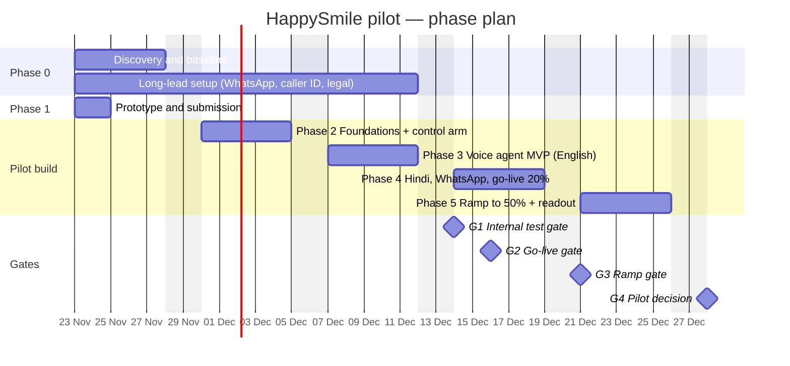

# HappySmile Lead Callback Assistant — Phase-wise Implementation Plan

> Built from [architecture.md](architecture.md) and [context.md](context.md). Section references such as **§4.13** point to architecture.md.
> This is a plan for a **fictional case**. Durations, team size and thresholds are proposals, and items marked **[Assumption]** need confirming with HappySmile.

---

## Table of contents

1. [Summary](#1-summary)
2. [Team and roles](#2-team-and-roles)
3. [Timeline](#3-timeline)
4. [Phase 0 — Discovery and long-lead setup](#4-phase-0--discovery-and-long-lead-setup)
5. [Phase 1 — Clickable prototype and case submission](#5-phase-1--clickable-prototype-and-case-submission)
6. [Phase 2 — Foundations and control arm (pilot week 1)](#6-phase-2--foundations-and-control-arm-pilot-week-1)
7. [Phase 3 — Voice agent MVP on Groq (pilot week 2)](#7-phase-3--voice-agent-mvp-on-groq-pilot-week-2)
8. [Phase 4 — Hindi, WhatsApp and limited go-live (pilot week 3)](#8-phase-4--hindi-whatsapp-and-limited-go-live-pilot-week-3)
9. [Phase 5 — Ramp and pilot readout (pilot week 4)](#9-phase-5--ramp-and-pilot-readout-pilot-week-4)
10. [Phase 6 — After the pilot (scale or stop)](#10-phase-6--after-the-pilot-scale-or-stop)
11. [Cross-cutting workstreams](#11-cross-cutting-workstreams)
12. [Go / no-go gates](#12-go--no-go-gates)
13. [Kill switch and rollback](#13-kill-switch-and-rollback)
14. [Risk register](#14-risk-register)
15. [Definition of done](#15-definition-of-done)

---

## 1. Summary

| Phase | Name | Duration | Outcome |
|---|---|---|---|
| **0** | Discovery and long-lead setup | ~1 week (before build) | Open questions answered, baseline measured, slow approvals started |
| **1** | Clickable prototype and case submission | 1–2 days (parallel with Phase 0) | Two-screen mockup at a public URL, plus the written answers |
| **2** | Foundations and control arm | Pilot week 1 | Enquiries flow into the system, leads are randomised, the control arm runs |
| **3** | Voice agent MVP on Groq | Pilot week 2 | English AI calls book or hand over, tested internally |
| **4** | Hindi, WhatsApp, limited go-live | Pilot week 3 | Live in 2–3 pilot clinics at a 20% assistant share |
| **5** | Ramp and pilot readout | Pilot week 4 | Ramp to 50% if guardrails hold; readout and decision |
| **6** | After the pilot | Weeks 5+ | Scale, iterate, or stop, based on evidence |

The order is deliberate:
- **Measurement comes before the AI.** The control arm and event log go live in Phase 2, before any AI call, so the pilot can show whether speed *causes* the lift rather than repeating the ops head's correlation (§2, §10).
- **Safety comes before scale.** The agent goes live at a small share behind explicit gates (§12), with a kill switch (§13).
- **Staff are in the loop from day one.** The front-desk lead signs off on the script and triggers before go-live and owns the thumbs-down review afterwards.

---

## 2. Team and roles

Assumed pilot team **[Assumption]**:

| Role | Count | Responsibilities |
|---|---|---|
| Product manager | 1 | Scope, gates, stakeholder alignment, pilot readout |
| Backend engineer | 1 | Intake, experiment assigner, orchestrator, booking, messaging, queue, events |
| Voice / AI engineer | 1 | Voice pipeline, Groq integration, guardrails, summariser, evaluation set |
| Frontend engineer | 1 (can be shared with backend) | Enquiry form, Leads console, prototype |
| Designer | 0.5 | Prototype, form and console UX, Hindi copy review |
| Front-desk lead (HappySmile) | Part-time | Script sign-off, trigger review, daily call review, staffing for the queue |
| Ops head (HappySmile) | Part-time | Baseline data, pilot clinic selection, readout |
| Legal / compliance | Part-time | DPDP consent, telecom classification, Groq data processing agreement |

### Recommended stack

Proposed defaults; any could change after Phase 0:

| Layer | Choice | Why |
|---|---|---|
| Enquiry form + Leads console | React (e.g. Next.js), TypeScript | One codebase for both screens; easy to deploy |
| Backend services | Python (FastAPI) | Mature real-time voice pipeline libraries; Groq Python SDK |
| Voice pipeline | Streaming STT → Groq LLM → TTS over the telephony provider's media stream | §4.5 |
| LLM | **Groq** (decided), via a single `LlmClient` | §4.13 |
| Database | Postgres (jobs table for the scheduler, events table) | §4.4, §11 |
| Object storage | S3-compatible, Indian region | Recordings and transcripts (§13) |
| Real-time console updates | Server-sent events | §9.4 |
| Hosting | One cloud provider, Indian region, staging + production | §13 |

---

## 3. Timeline

Dates are illustrative and assume a start on Monday 2026-11-23.

---

## 4. Phase 0 — Discovery and long-lead setup

**Goal:** answer the questions that change the design, and start the slow external approvals so they do not block go-live in week 3.

### 4.1 Discovery tasks

| ID | Task | Output | Owner |
|---|---|---|---|
| P0-01 | Pull historical enquiry data: time to first call vs booking, by hour, clinic, treatment | Baseline report; check for selection bias in the "3x" claim | PM + ops head |
| P0-02 | Map the current callback process at 2–3 clinics (who calls, when, with what script) | Process map; staff capacity per clinic | PM + front-desk lead |
| P0-03 | Find out where clinic calendars live and whether there is an API | Decision: booking adapter vs pilot slot store (§4.7) | Backend engineer |
| P0-04 | Measure out-of-hours enquiry share and language mix per clinic | Inputs for the calling window and Hindi priority | PM |
| P0-05 | Agree the price policy: approved "starting from" card, or always hand over | Price card or "no prices" decision (§7.3) | PM + founder |
| P0-06 | Agree the disclosure policy with the founder (virtual assistant named on the form and in the first sentence) | Signed-off disclosure wording (§7.2) | PM + founder |
| P0-07 | Choose pilot clinics (2–3, willing front-desk teams, mixed language) | Pilot clinic list | Ops head + front-desk lead |
| P0-08 | Agree handover SLAs and staffing for the "Needs you" queue | SLA targets (§8.1) and a named staff member per shift | Front-desk lead |

### 4.2 Long-lead setup (start now, finishes during Phases 2–4)

| ID | Item | Why it is slow | Needed by |
|---|---|---|---|
| P0-10 | Telephony account, KYC and a registered Indian caller ID | Provider verification and number provisioning | Phase 3 internal calls |
| P0-11 | WhatsApp Business account + template submissions (acknowledge, confirm, no-answer, reminder) | Meta template review; rejections need rewording | Phase 4 |
| P0-12 | Groq account, plan tier and rate limits for ~4 requests/s at peak (§4.13) | Plan upgrades and limit increases may take time | Phase 3 |
| P0-13 | Groq data processing terms: processing regions and retention | Legal review; may require extra redaction or an alternative | **G2 go-live gate** |
| P0-14 | DPDP consent wording and telecom classification review | Legal sign-off | G2 |
| P0-15 | STT/TTS vendor trial on real Hindi/Hinglish audio samples | Needs sample audio and vendor accounts | Phase 4 |

### 4.3 Exit criteria

- Baseline report exists, and the selection-bias question has a written answer.
- Booking approach decided (API adapter or pilot slot store).
- Disclosure wording and price policy signed off.
- Pilot clinics and handover staffing confirmed.
- All long-lead items submitted, with owners and expected dates.

---

## 5. Phase 1 — Clickable prototype and case submission

**Goal:** produce the case deliverables in [context.md Part 2](context.md#part-2--what-must-be-submitted-google-form). This can run in parallel with Phase 0 and does not depend on any backend.

### 5.1 Prototype tasks (architecture §19)

| ID | Task | Detail |
|---|---|---|
| P1-01 | Set up a static project (`/prototype`) with shared styles | Calm clinical palette, readable contrast, no emoji |
| P1-02 | Write fictional mock data (`leads.json`, `clinics.json`) | Every handover tag; one urgent lead near or over its SLA; booked-pending-review; no-answer retry and WhatsApp-sent; standard callback; one Hinglish transcript. Top-strip numbers match the lists |
| P1-03 | Screen 1: Request a call (~390 px) | Fields, contact preference (default "Call me now"), English/Hindi toggle, disclosure, consent gate, "Request my call", confirmation with calling number and 2:00 countdown |
| P1-04 | Screen 2: Leads (~1280 px) | Top strip, four tabs in order, tags, live SLA timers, side panel (summary, captured answers, snippet, play button), actions, thumbs feedback, booking Review dialog |
| P1-05 | Link the two screens | A small "View as clinic staff" link |
| P1-06 | Deploy to Vercel, Netlify or GitHub Pages | Check the link in a private window: it must open without a login |
| P1-07 | Review pass | No lorem ipsum, no real branding, all made-up phone numbers, keyboard-usable, contrast checked |

No live LLM calls and no API keys in the prototype (§19.1).

### 5.2 Written answers (sources in the docs)

| Submission item | Source material |
|---|---|
| Brief (≤ 300 words): 4-week ship, explicitly NOT doing | architecture §1 scope table, §18 |
| One success metric, one ignored metric | §15.1: enquiry → consult booked by arm; ignore call duration / "sounds human" |
| Handling the founder and the front-desk lead | §2 principles 2 and 3, §8, §9 |
| Three questions before building | Pick three from §17 (suggested: the "3x" measurement, calendar system, handover staffing) |
| Most likely failure in month one | §16 row 1: the front desk cannot keep up with the handover queue |
| AI suggestion rejected (≤ 3 lines) | Your own experience while preparing; leave blank if none |

### 5.3 Exit criteria

- Public URL opens without login on mobile and desktop.
- Brief word count ≤ 300; the AI note is ≤ 3 lines.
- Every item in the [context.md checklist](context.md#quick-reference-checklist-derived) is ticked.

---

## 6. Phase 2 — Foundations and control arm (pilot week 1)

**Goal:** real enquiries enter the system, are randomised, and the **control arm runs from day one**. No AI calls yet; at this point every lead goes through the standard callback.

### 6.1 Work breakdown

| ID | Task | Arch ref | Owner |
|---|---|---|---|
| P2-01 | Repo, CI, staging + production environments, secrets manager | §13 | Backend |
| P2-02 | Postgres schema: `lead`, `consent`, `call_attempt`, `handover`, `booking`, `slot`, `message`, `event`, reference tables | §11 | Backend |
| P2-03 | Enquiry form (production version of Screen 1): validation, consent gate, idempotent submit | §4.1 | Frontend |
| P2-04 | `POST /v1/enquiries`: normalise, dedupe (same phone in 24 h), immutable consent record, rate limiting | §4.2, §12 | Backend |
| P2-05 | Experiment assigner: deterministic hash, stratified by clinic, write-once arm. **Assistant share set to 0%** for now | §4.3 | Backend |
| P2-06 | Append-only event log and `lead.created` / `lead.assigned` events | §4.12 | Backend |
| P2-07 | Leads console skeleton: login, clinic scoping, top strip, **Standard callback** tab with outcome capture ("reached at", booked / not interested / unreachable) | §9 | Frontend |
| P2-08 | Staff booking for control-arm leads (pilot slot store or adapter, per P0-03) | §4.7 | Backend |
| P2-09 | Basic metrics endpoint and SSE stream | §12 | Backend |
| P2-10 | Audit logging and role-based access | §13 | Backend |

### 6.2 Exit criteria

- Pilot-clinic enquiries arrive in the console within seconds of submit.
- Staff record outcomes for control-arm leads, so time to first reach and booking are measured the same way they will be for the assistant arm.
- The event log reproduces the top-strip numbers exactly.
- Dedupe, consent capture and idempotency are covered by automated tests.

---

## 7. Phase 3 — Voice agent MVP on Groq (pilot week 2)

**Goal:** an English-language AI call that discloses, qualifies, books or hands over, safely and quickly. **Internal testing only**; no real patients yet.

### 7.1 Work breakdown

| ID | Task | Arch ref | Owner |
|---|---|---|---|
| P3-01 | `LlmClient` wrapping Groq Chat Completions: pinned model IDs in config (`LLM_DIALOGUE_MODEL`, `LLM_GUARD_MODEL`, `LLM_SUMMARY_MODEL`), timeouts, 429 handling, redaction, prompt versioning | §4.13 | Voice/AI |
| P3-02 | Telephony integration: outbound call, status webhooks, media stream, recording | §4.5, §12 | Voice/AI |
| P3-03 | Streaming STT and TTS (English); pre-generated audio for greeting, disclosure, recording notice, filler lines | §4.5, §7.4 | Voice/AI |
| P3-04 | Conversation state machine, stages 1–7; disclosure fixed in code | §7.1, §7.2 | Voice/AI |
| P3-05 | Tool allowlist enforced server-side: slots, hold, book, handover, not interested, end call | §4.5 | Voice/AI + Backend |
| P3-06 | Guardrails: rules and keywords first (person request, pain/swelling, price/EMI, clinical, low confidence); Groq small-model classifier in parallel; output-side checks | §4.6 | Voice/AI |
| P3-07 | Call orchestrator: durable job table, calling window, attempt 1 within ~60 s, circuit breaker → staff queue | §4.4 | Backend |
| P3-08 | Handover queue service: reason tags, urgency, SLA timers, claim/soft-lock, escalation | §4.9 | Backend |
| P3-09 | Console: **Needs you** and **Booked by assistant** tabs, side panel, actions, thumbs feedback, Review dialog | §9 | Frontend |
| P3-10 | Post-call summariser on Groq: 3-line summary + captured answers as JSON, validated against structured fields | §4.10 | Voice/AI |
| P3-11 | Evaluation set: at least 60 scripted test conversations (happy path, each handover reason, interruptions, "are you a robot?", wrong person, not interested, silence) | §15.3 | Voice/AI + front-desk lead |
| P3-12 | Internal test calls: staff act as patients on real phones | — | Whole team |

### 7.2 Exit criteria (gate **G1**, see §12)

- The evaluation set passes the G1 thresholds.
- The front-desk lead has listened to sample calls and signed off on the script, tone and handover lines.
- The circuit breaker is tested: with Groq or telephony disabled, leads land in "Needs you" with `system_fallback`.

---

## 8. Phase 4 — Hindi, WhatsApp and limited go-live (pilot week 3)

**Goal:** add Hindi and WhatsApp, then go live with **real patients at a 20% assistant share** in the pilot clinics.

### 8.1 Work breakdown

| ID | Task | Arch ref | Owner |
|---|---|---|---|
| P4-01 | Hindi and Hinglish: STT/TTS (vendor from P0-15), Hindi prompts and fixed lines, mid-call language switch | §4.5 | Voice/AI |
| P4-02 | Hindi extension of the evaluation set (at least 30 conversations), reviewed by a native speaker | §15.3 | Voice/AI + designer |
| P4-03 | Messaging service: approved templates (acknowledge, confirm, no-answer, reminder), delivery status, inbound replies → "Needs you" | §4.8 | Backend |
| P4-04 | Retry policy: +5 min, +2 h, then WhatsApp; voicemail detection; invalid-number handling | §4.4 | Backend |
| P4-05 | Contact preferences: "Call me at a time I pick" (scheduled + reminder) and "WhatsApp me instead" | §5 notes | Backend + frontend |
| P4-06 | **No answer** tab with attempt history | §9.3 | Frontend |
| P4-07 | Booking review flow end to end (approve / change / cancel → WhatsApp update) | §4.7 | Backend + frontend |
| P4-08 | Dashboards and alerts: first-dial p90, Groq TTFT and 429s, SLA breaches, template failures | §15.2 | Backend |
| P4-09 | Staff training session (30 min) and a one-page guide for the console | — | PM + front-desk lead |
| P4-10 | **Go-live**: pass gate G2, then set the assistant share to 20% in pilot clinics | §10 | PM |

### 8.2 First live days

- **Day 1:** a team member listens live or soon after to every assistant call.
- **Days 2–5:** daily review of 10 calls per clinic (§15.3), plus every thumbs-down and every rejected booking.
- Same-day fixes to prompts and keyword lists, versioned and logged.

### 8.3 Exit criteria

- At least 3 days live at 20% with no safety incident.
- Gate G3 metrics measured.

---

## 9. Phase 5 — Ramp and pilot readout (pilot week 4)

**Goal:** if guardrails hold, ramp to a 50/50 split, collect enough data, and produce an honest readout.

### 9.1 Work breakdown

| ID | Task | Owner |
|---|---|---|
| P5-01 | Pass gate G3, then raise the assistant share 20% → 50% | PM |
| P5-02 | Continue daily call reviews; weekly thumbs-down review with the front-desk lead | Front-desk lead + Voice/AI |
| P5-03 | Tune triggers and prompts based on handover reason mix and feedback | Voice/AI |
| P5-04 | Collect attendance data for bookings made in weeks 3–4 | Ops head |
| P5-05 | Pilot readout (see 9.2) | PM |

### 9.2 Readout contents

| Question | Metric (§15.1) |
|---|---|
| Did the assistant raise bookings? | Enquiry → consult booked within 7 days, **by arm**, with confidence intervals |
| Are the bookings real? | Consult attended, by arm (early data) |
| Did speed actually change? | Time to first contact p50/p90, by arm |
| Can staff keep up? | Handover SLA hit rate, waiting times |
| Is it safe and trusted? | Urgent handovers on time; booking review rejection rate; complaints and opt-outs; thumbs-down rate |
| Where is the agent weak? | Handover reason mix; "couldn't understand" rate by language |
| What does it cost? | Telephony minutes, STT/TTS, Groq tokens per lead |

Not reported as a success measure: call duration or "sounds human" ratings (§15.1).

### 9.3 Decision (gate **G4**)

| Result | Decision |
|---|---|
| Clear lift in bookings, attendance not worse, guardrails healthy | **Scale**: go to Phase 6, add clinics in waves |
| Guardrails healthy but lift unclear | **Extend**: run 2–4 more weeks at 50/50 for statistical power; fix the weakest handover reasons |
| Lift appears but SLA or review metrics are poor | **Fix first**: staffing or agent quality before adding clinics |
| Safety incidents, or bookings hold but attendance drops | **Stop or redesign**: assistant share back to 0%; review the approach |

---

## 10. Phase 6 — After the pilot (scale or stop)

Only if G4 says scale. Candidates, roughly in priority order:

| Item | Why now | Arch ref |
|---|---|---|
| Roll out to the remaining clinics in waves of 3 | Proven in the pilot; stratified randomisation can continue with a small control share | §10 |
| Calendar API integration (replace the pilot slot store) | Removes manual slot upkeep, the main booking-error source | §4.7, §16 row 4 |
| Live warm transfer to staff for "asked for a person" during staffed hours | Out of scope in v1; reduces handover wait | §1 |
| Reminder and no-show recovery calls | Protects attendance | §1 out-of-scope list |
| More languages per clinic (based on P0-04 data) | Reduces "couldn't understand" | §17 |
| India-hosted LLM option, if the Groq data review requires it | Data residency | §4.13, §17 |
| Keep a small permanent control share (e.g. 10%) | Continuous measurement of lift | §10 |

---

## 11. Cross-cutting workstreams

### 11.1 Testing strategy

| Layer | Approach | When |
|---|---|---|
| Unit | Dedupe, arm assignment, retry scheduling, SLA calculation, tool allowlist | Every PR from Phase 2 |
| Integration | Webhook signature checks and idempotency; booking hold/confirm races; circuit breaker | Phase 2–3 |
| Conversation evaluation | Scripted evaluation set run against the agent after every prompt or model change; must not regress | Phase 3 onward |
| Safety tests | 100% recall on urgent and "talk to a person" cases in the evaluation set; no claim to be human; no medical advice | Every agent change |
| Load | Simulate 10 concurrent calls and 45 leads/hour; confirm Groq rate limits and turn latency | Before G2 |
| Live review | Daily sampled call reviews | Phase 4 onward |

### 11.2 Groq-specific checklist (§4.13)

- [ ] Plan tier covers ~4 requests/s at peak with headroom (P0-12).
- [ ] Model IDs pinned in config; deprecation notices assigned to an owner.
- [ ] API key in the secrets manager only; never in the form, the console or the prototype.
- [ ] Phone numbers never sent; first name only when needed.
- [ ] Timeouts, 429 retry and fallbacks tested (filler line → retry → `system_fallback`).
- [ ] TTFT, 429 and timeout dashboards live.
- [ ] Data processing terms reviewed and accepted (P0-13) before G2.

### 11.3 Compliance and privacy

- Consent wording versioned; consent records immutable (§4.2, §14).
- Recording notice in the first turn; 90-day retention job in place before go-live.
- Suppression list ("don't call me", "STOP") honoured by the orchestrator and messaging.
- Minors policy confirmed and implemented as a handover trigger.

### 11.4 Change management

- The front-desk lead co-owns the script, triggers and the weekly feedback review.
- Staff can see every AI booking and review it; nothing the AI does is hidden from them.
- A weekly 15-minute readout to the founder, ops head and front-desk lead, using the same dashboard.

---

## 12. Go / no-go gates

| Gate | When | Must be true |
|---|---|---|
| **G1 — Internal test** | End of Phase 3 | Evaluation set: 100% disclosure in the first sentence; 100% recall on urgent and "talk to a person" cases; 0 disallowed tool calls executed; 0 claims to be human or medical advice; ≥ 90% correct handling across all scenarios; p90 turn latency ≤ 1.2 s; circuit breaker tested; front-desk lead sign-off |
| **G2 — Go-live with patients** | Mid Phase 4 | G1 still passing with Hindi; WhatsApp templates approved; registered caller ID live; legal sign-off on consent, telecom classification and the Groq data terms; staff trained and the handover rota staffed; kill switch tested; alerts live |
| **G3 — Ramp to 50%** | End of Phase 4 | ≥ 3 live days at 20%; no missed urgent handover; handover SLA hit rate ≥ 80%; booking review rejection rate ≤ 5%; no unresolved complaint about the AI; no control-arm contamination |
| **G4 — Pilot decision** | End of Phase 5 | Readout complete; decision recorded using the table in §9.3 |

---

## 13. Kill switch and rollback

| Trigger | Action |
|---|---|
| Any missed urgent handover, any call without disclosure, any medical advice given | Assistant share → **0%** immediately; all assistant-arm leads go to staff; incident review before resuming |
| Booking review rejection rate > 15% in a day | Pause AI booking; the agent still calls and qualifies, but every lead is handed over |
| Handover SLA hit rate < 60% for a day | Reduce the assistant share until staffing catches up |
| Groq or telephony outage | Automatic circuit breaker (§4.4); no manual action needed |

The assistant share is a config value that takes effect without a deploy. Because arm assignment is write-once, changing the share only affects new leads, so the experiment stays valid.

---

## 14. Risk register

Mapped to architecture §16, with an owner and the phase where it is addressed.

| Risk | Likelihood | Impact | Mitigation phase | Owner |
|---|---|---|---|---|
| Front desk cannot keep up with "Needs you" | High | High | P0-08 staffing, G3 SLA gate, kill switch | Front-desk lead |
| Weak Hindi/Hinglish recognition | Medium | High | P0-15 vendor trial, P4-02 evaluation | Voice/AI |
| Calls from an unknown number go unanswered or get flagged as spam | Medium | Medium | P0-10 registered caller ID; number shown on the form | Backend |
| Booking errors from a stale pilot slot store | Medium | High | Holds, review queue, named slot owner | Ops head |
| Low-quality bookings inflate the metric | Medium | Medium | Attendance tracked by arm (P5-04) | PM |
| Staff distrust or bypass | Medium | High | Co-ownership, review rights, weekly readout | PM |
| Control-arm contamination | Low | High | Locked arm in the console; event-log check at G3 | Backend |
| Founder pushes to drop the disclosure | Medium | High | Signed-off disclosure in P0-06 | PM |
| Groq data terms not acceptable | Low–Medium | High | P0-13 early; India-hosted fallback considered in Phase 6 | Legal + Voice/AI |
| Groq rate limits or model retirement | Low | Medium | P0-12 plan check; pinned models; fallbacks | Voice/AI |
| WhatsApp templates rejected | Medium | Medium | Submit in week 0; keep wording plain and transactional | Backend |

---

## 15. Definition of done

A task is done when:
- the code is reviewed, merged, and deployed to staging;
- automated tests cover the main path and the main failure path;
- it emits the events the metrics need (§4.12);
- any patient-facing wording is approved in English and Hindi;
- any change to prompts or rules is versioned, and the evaluation set still passes;
- the runbook is updated if on-call behaviour changed.

The pilot is done when gate **G4** has a recorded decision and the readout is shared with the founder, ops head and front-desk lead.
